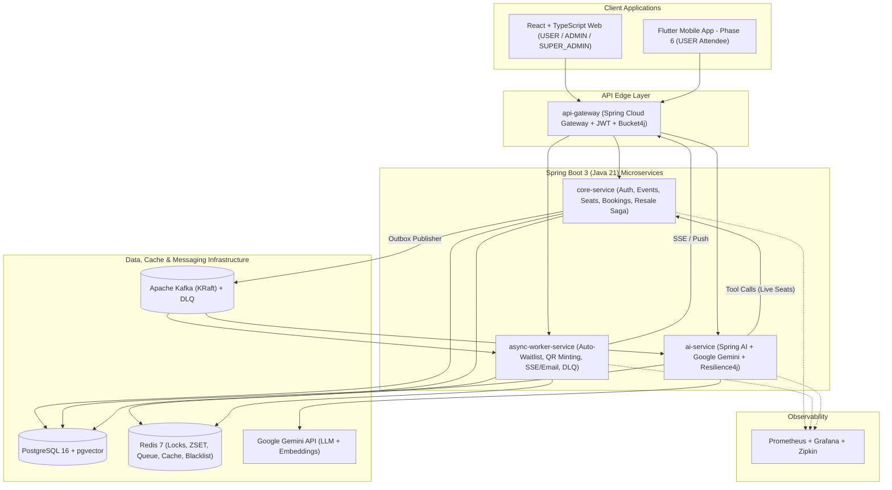
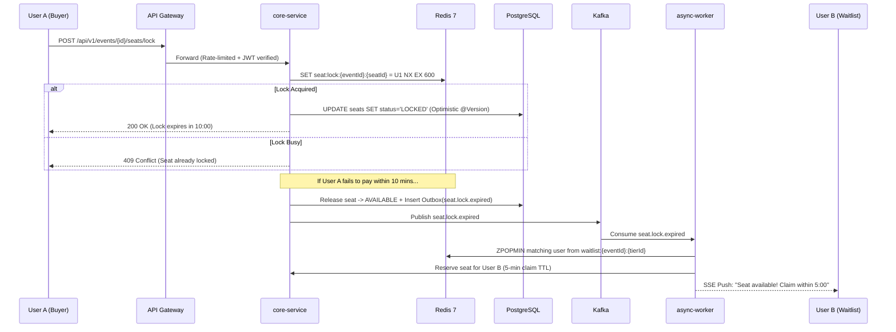

# 02 — High-Level Design (HLD)

## 1. System Architecture Diagram

---

## 2. Service Boundaries & Responsibilities

### 2.1 `api-gateway` (Port `8080`)
* **Responsibilities:**
  * Single external entry point for both React Web and Flutter Mobile clients.
  * Stateless JWT signature verification + Redis blacklist check (`jwt:blacklist:{jti}`).
  * Injects verified headers (`X-User-Id`, `X-User-Role`, `X-Correlation-Id`) downstream.
  * Per-IP and per-User **Redis Bucket4j** rate limiting (strict limits on `/api/v1/seats/lock` and `/api/v1/auth/login` to stop scalper bots).
  * CORS configuration for Web and Mobile clients.

### 2.2 `core-service` (Port `8081`)
* **Responsibilities:**
  * **Auth & RBAC:** Registration, login, refresh token rotation, Organizer approval workflow, `@Audited` AOP logging.
  * **Event & Seat Management:** Event CRUD, venue seat-map generation, flash-sale virtual waiting room admission.
  * **High-Concurrency Booking Engine:** Redisson distributed seat locks, JPA `@Version` optimistic locking, idempotent checkout (`Idempotency-Key`), payment webhook handler.
  * **Resale Escrow Saga:** Price-cap validation, escrow settlement, atomic ownership transfer + QR invalidation.
  * **Transactional Outbox:** Writes domain events to `outbox_events` in the same DB transaction as state mutations; a scheduled poller (using Java 21 Virtual Threads) relays them to Kafka reliably.

### 2.3 `async-worker-service` (Port `8082`)
* **Responsibilities:**
  * **Smart Auto-Waitlist Engine:** Consumes `seat.lock.expired` and `booking.cancelled` events -> queries Redis `ZSET` waitlist -> acquires seat lock for top matching user -> emits `waitlist.seat.offered`.
  * **QR Ticket Service:** Consumes `booking.confirmed` and `resale.completed` -> mints HMAC-SHA256 signed QR payload -> stores ticket metadata.
  * **Real-Time Notifications:** Streams Server-Sent Events (SSE) to connected Web/Flutter clients (queue position, waitlist claim alerts, booking confirmation) + sends emails via MailHog/SMTP.
  * **DLQ Management:** Captures poison-pill messages in `*.dlq` topics and exposes `SUPER_ADMIN` replay endpoints.

### 2.4 `ai-service` (Port `8083`)
* **Responsibilities:**
  * **Semantic Indexing:** Consumes `event.published` from Kafka -> generates vector embeddings via **Google Gemini Embedding Model** -> persists to `event_embeddings` (`pgvector`).
  * **AI Event Concierge (`USER`):** Uses Spring AI `ChatClient` (Gemini) with hybrid search (`pgvector` cosine similarity + SQL metadata filters) and `@Tool` function calling into `core-service` to verify **real-time adjacent seat availability**.
  * **AI Pricing & Demand Co-Pilot (`ADMIN`):** Evaluates live waitlist depth, view-to-lock ratio, and similar historical events to return structured JSON pricing/capacity advice.
  * **Fault Tolerance:** Wrapped in **Resilience4j** (`@CircuitBreaker`, `@TimeLimiter`, `@Retry`). If Gemini is slow or unavailable, falls back seamlessly to deterministic PostgreSQL search.

---

## 3. Key System Design Flows

### 3.1 Flash-Sale Seat Lock & Auto-Waitlist Sequence

### 3.2 Anti-Scalper Resale Escrow Saga
1. Seller (`USER`) lists booked ticket at price `P <= originalPrice * event.maxResaleMultiplier`.
2. Buyer (`USER`) initiates resale purchase with `Idempotency-Key`.
3. **Saga Step 1:** Acquire Redis lock on `resale:lock:{listingId}` -> reserve listing (`PENDING_SETTLEMENT`).
4. **Saga Step 2:** Capture Buyer payment into Escrow (idempotent).
5. **Saga Step 3 (Atomic DB Transaction):**
   * Mark Seller's old ticket `TRANSFERRED` & `qr_revoked = true`.
   * Write old `qr_token_id` to Redis `qr:revoked:{qrTokenId}` (instant venue-scanner rejection).
   * Mint new Ticket record for Buyer with fresh HMAC-SHA256 QR token.
   * Credit Seller payout ledger & Platform fee ledger.
   * Write `resale.completed` to `outbox_events`.
6. **Compensation:** If Step 2 or Step 3 fails, release Redis lock, revert listing to `ACTIVE`, and refund Buyer if payment was captured.

---

## 4. Multi-Client Strategy (React Web + Flutter Mobile)
* **Backend is 100% client-agnostic:** All endpoints use standard JSON, cursor/page-based pagination, and RFC 7807 `ProblemDetail` errors.
* **Web (`frontend/`):** Serves all 3 roles (`USER`, `ADMIN`, `SUPER_ADMIN`).
* **Flutter (`mobile/` — Phase 6):** Dedicated **Attendee (`USER`)** mobile app for 60fps seat selection, native push/SSE waitlist alerts, and **offline-cached QR ticket wallet** (crucial at crowded concert venues with weak cell signal).

